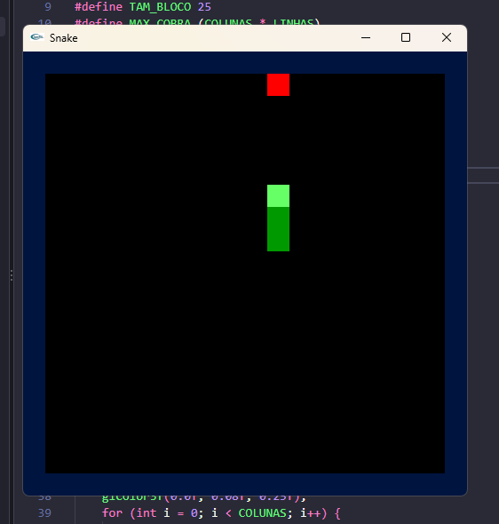
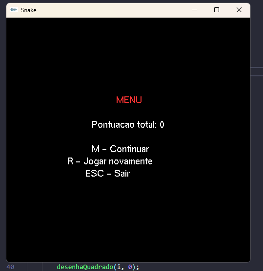
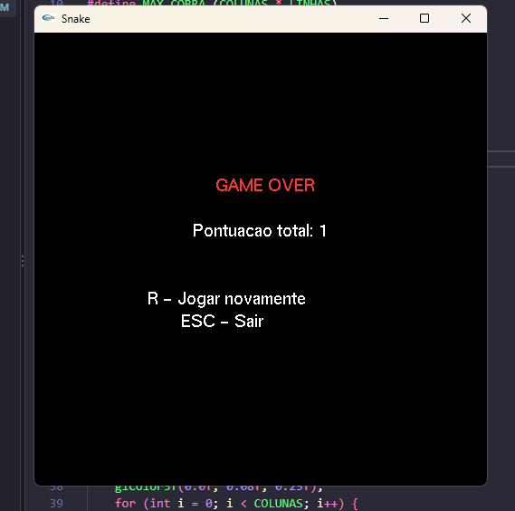

# Relatório – Jogo da Cobra em C com OpenGL/GLUT

**Autor:** Eduardo Felipe Alves de Sousa

## 1. Introdução

Este trabalho implementa o jogo da cobra (*Snake*) em linguagem C, usando OpenGL e GLUT para a parte gráfica e a interação com o teclado. O código-fonte completo está em `snakegame.c`.

## 2. Como compilar e executar

Windows com MinGW:

```sh
gcc -std=c99 -o snakegame.exe snakegame.c -lglu32 -lglut32 -lopengl32
./snakegame.exe
```

O `glut32.dll` precisa estar na mesma pasta do executável (já incluído neste pacote).

### Controles

| Tecla | Ação |
| --- | --- |
| Setas ou W A S D | Mover a cobra |
| ESC ou M | Abrir o menu (pausa o jogo); M também continua |
| R | Jogar novamente (no menu ou no game over) |
| ESC (no menu ou game over) | Sair |

## 3. Desenvolvimento

### 3.1 Cenário

O cenário é uma grade de 20×20 blocos, cada um com 25 pixels (janela de 500×500). A projeção é definida por `gluOrtho2D(0, COLUNAS, 0, LINHAS)`, de modo que cada bloco ocupa exatamente uma unidade e todo o desenho usa coordenadas inteiras da grade. As bordas (azul-escuro) formam a parede do jogo.

### 3.2 Estruturas e estado

A cobra é guardada em dois vetores, `cobraX[]` e `cobraY[]`, onde o índice 0 é a cabeça. As demais variáveis de estado são `tamanho`, a direção atual (`dirX`, `dirY`), a próxima direção pedida pelo jogador (`proxDirX`, `proxDirY`), a posição da peça (`pecaX`, `pecaY`), `pontos`, `velocidade` (intervalo do timer em ms), `gameOver` e `menuAberto`.

### 3.3 Funções principais

| Função | Papel |
| --- | --- |
| `desenhaQuadrado` | Desenha um bloco da grade com `GL_POLYGON` |
| `desenhaBordas`, `desenhaCobra`, `desenhaPeca` | Desenham os elementos do cenário |
| `desenhaMenu` | Mostra a tela de menu/game over com a pontuação |
| `moveCobra` | Desloca o corpo e avança a cabeça um bloco |
| `verificaColisao` | Detecta batida na parede ou no próprio corpo |
| `comePeca` | Aumenta a cobra, soma ponto, acelera e gera nova peça |
| `geraPeca` | Sorteia posição da peça fora do corpo da cobra |
| `timer` | Laço do jogo, chamado por `glutTimerFunc` |
| `teclado`, `tecladoLetras` | Tratam setas, WASD, M, R e ESC |

### 3.4 Regras implementadas

- A cobra começa com 3 blocos, indo para a direita.
- Comer a peça vermelha vale 1 ponto e adiciona um bloco (na posição da antiga cauda).
- A cada 5 pontos o intervalo do timer cai 20 ms (de 150 ms até o mínimo de 50 ms).
- O jogo termina ao bater na parede ou no corpo.
- Não é possível inverter a direção de 180° (a cobra não "volta" sobre si mesma).
- A direção só é aplicada no próximo tick do timer (`proxDir`), evitando que dois comandos rápidos no mesmo tick causem uma inversão.
- O menu (tecla ESC ou M) pausa o jogo: o timer continua rodando, mas não move a cobra enquanto o menu está aberto. Isso evita criar timers duplicados ao continuar ou reiniciar.

### 3.5 Recursos de OpenGL/GLUT usados

- Janela e *double buffering*: `glutInitDisplayMode(GLUT_DOUBLE | GLUT_RGB)` e `glutSwapBuffers`, que evitam cintilação.
- Projeção ortográfica 2D: `gluOrtho2D`.
- Primitivas: `glBegin(GL_POLYGON)` com `glVertex2i`.
- Texto: `glRasterPos2f` e `glutBitmapCharacter`.
- Eventos: `glutDisplayFunc`, `glutSpecialFunc`, `glutKeyboardFunc`, `glutTimerFunc`.

## 4. Resultados

Compilado com GCC (MinGW) no Windows 11, sem erros nem avisos. O jogo foi executado e apresentou o seguinte comportamento:

1. **Início:** assim que a janela abre, o jogo já começa em movimento, sem tela de espera: a cobra verde de 3 blocos (cabeça em verde-claro) sai do centro para a direita, com a peça vermelha em posição aleatória e a borda azul-escura ao redor. O jogador pode mudar a direção logo de cara ou abrir o menu (M) para pausar.
2. **Jogo:** a cobra se move continuamente; as setas e WASD mudam a direção; ao comer a peça, a cobra cresce, a pontuação sobe e surge uma nova peça.
3. **Aceleração:** a cada 5 peças o movimento fica mais rápido, até o limite de 50 ms por passo.
4. **Menu (ESC ou M):** o jogo pausa e exibe "MENU", a pontuação e as opções Continuar, Jogar novamente e Sair.
5. **Game over:** ao bater na parede ou no corpo, aparece "GAME OVER" com a pontuação total; R reinicia e ESC encerra.

> Inicio do jogo em movimento


> Menu do jogo


> Game over com pontuação total


## 5. Discussão

- **Grade inteira:** usar coordenadas inteiras de grade com `gluOrtho2D` simplificou a colisão e o desenho. Comparações são feitas entre inteiros, sem tolerância de ponto flutuante, e o tamanho em pixels fica isolado em `TAM_BLOCO`.
- **Timer em vez de `idle`:** `glutTimerFunc` dá velocidade previsível e independente do computador, e permite acelerar apenas mudando o intervalo.
- **Direção pendente:** guardar a próxima direção em `proxDirX/Y` e aplicá-la só no tick evita um defeito comum: virar duas vezes entre dois ticks e acabar invertendo a cobra sobre si mesma.
- **Pausa sem parar o timer:** parar e recriar o timer podia gerar timers duplicados (cobra com o dobro da velocidade). Manter um único timer que apenas ignora o movimento durante o menu é mais simples e seguro.
- **Limitações:**
  - Se a cobra ocupar todo o interior do tabuleiro (18×18 = 324 blocos), `geraPeca` entra em laço infinito, pois não há posição livre. Na prática é muito improvável de acontecer.
  - O texto usa fonte bitmap fixa do GLUT, sem acentuação.
  - Não há recorde persistente nem som.
- **Possíveis melhorias:** salvar o recorde em arquivo, adicionar obstáculos e níveis, tratar a vitória quando o tabuleiro enche e usar *shaders*/OpenGL moderno em vez do modo imediato.

## 6. Conclusão

No fim o jogo ficou como um Snake funcional: desenho 2D com OpenGL, entrada por teclado, animação por timer, colisões, pontuação, dificuldade progressiva, menu e reinício. O uso de uma grade inteira e de um único timer manteve o código curto e fácil de entender.

## 7. Conteúdo do pacote

- `snakegame.c` – código-fonte
- `snakegame.exe` – executável compilado
- `glut32.dll` – biblioteca necessária para executar
- `README.md` – instruções rápidas
- `RELATORIO.md` – este relatório

## 8. Comentários

Tive algumas dificuldades com a compilação do GLUT e acabei decidindo fazer dessa forma, ajustando tudo dentro do VS Code. Para compilar e gerar o jogo nos testes, precisei colocar a pasta do `gcc` no PATH das variáveis de ambiente e trazer as bibliotecas `glu32`, `glut32` e `opengl32`, que peguei dentro do MinGW que vem no Dev-C++.

Também foi preciso deixar o `glut32.dll` na pasta do projeto para o `.exe` achar a DLL ao abrir.